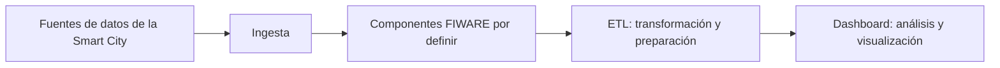

# Proyecto 3 — Smart City con FIWARE

## Descripción

Proyecto del módulo de Big Data Aplicado dedicado al tratamiento y
análisis de datos de una ciudad inteligente utilizando FIWARE.

Este repositorio contiene la estructura inicial para organizar la
ingesta, el procesamiento y la visualización de los datos.

## Objetivo

Preparar un entorno de trabajo para desarrollar una solución de
Smart City con FIWARE.

En esta primera fase se prepara el repositorio Git y la documentación.
Las fuentes de datos, los componentes de FIWARE y su configuración
se definirán en el bloque correspondiente.

## Arquitectura

El siguiente diagrama representa una propuesta inicial. No describe
servicios ya desplegados.



## Estructura del repositorio

```text
Proyecto3/
├── ingesta/
├── etl/
├── dashboard/
├── .gitignore
└── README.md
```

- `ingesta/`: futuros procesos de incorporación de datos de la Smart City.
- `etl/`: futuros procesos de extracción, transformación y carga.
- `dashboard/`: futura visualización de los resultados.
- `.gitignore`: reglas para excluir datos, credenciales y archivos locales.
- `README.md`: documentación principal del proyecto.

## Entorno base del módulo

- Git y cuenta en GitHub.
- Docker Desktop y Docker Compose.
- Python 3.10 o superior y pip.
- Editor de código, como Visual Studio Code.

## Estado actual

Repositorio en fase de preparación inicial.

Los componentes de FIWARE y los procesos de tratamiento de datos
están pendientes de implementación.
El archivo de Docker Compose se incorporará en el bloque correspondiente.